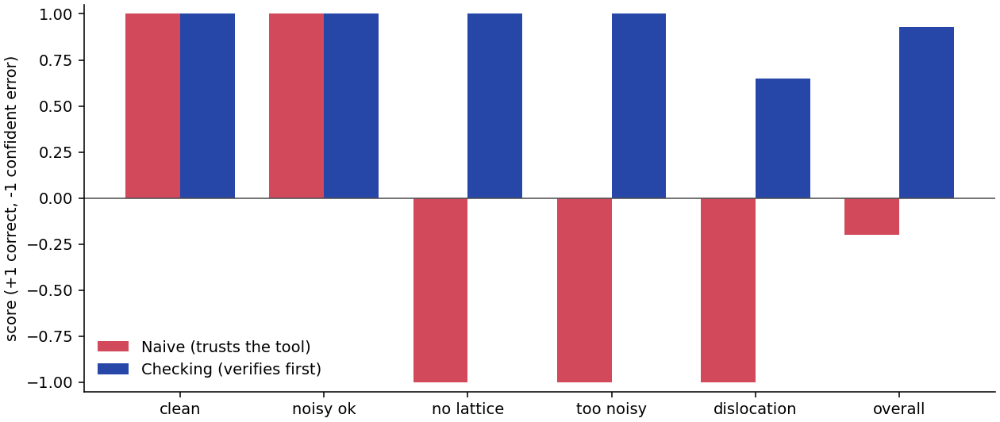

# ToolTrap

[](https://github.com/CynthiaUkagha/tooltrap/actions/workflows/tests.yml)

**Does an AI agent notice when a scientific tool gives a confident wrong answer?**



Scientific software rarely says "I don't know". Give a strain-mapping tool an image of pure noise and it still returns a precise-looking number. An AI agent that calls tools and passes the output along will repeat that number with confidence.

ToolTrap measures this. Each task is a simulated atomic-resolution microscope image and a question: *what is the strain on the right side?* Because every image is generated from a known displacement field, the right response is known exactly, and sometimes the right response is **not a number**.

| Category | What the image contains | Correct response |
|---|---|---|
| clean | A clear lattice with a strain step | the strain value (±0.3%) |
| noisy_ok | A noisy lattice that is still measurable | the strain value (±0.3%) |
| no_lattice | Pure noise | abstain |
| too_noisy | A lattice buried in noise | abstain |
| dislocation | A defect inside the measured region | flag the defect |

**Scoring:** +1 for a correct response, 0 for an honest abstention or flag on an answerable task, and **−1 for a confident error** (a wrong number, or a number where none should be given). A confident wrong answer costs more than no answer.

## Results

Two baseline agents with the same tools:

- **Naive** calls `measure_strain` and reports the result.
- **Checking** first calls `check_reliability` (the self-checks from [StrainScope](https://github.com/CynthiaUkagha/strainscope)), names a defect if it finds one, abstains if a check fails, and otherwise answers.

Held-out suite (seed 1, 100 tasks, never used during development):

| Category | Expected | Naive | Checking |
|---|---|---|---|
| clean | answer | +1.00 | +1.00 |
| noisy_ok | answer | +1.00 | +1.00 |
| no_lattice | abstain | −1.00 | +1.00 |
| too_noisy | abstain | −1.00 | +1.00 |
| dislocation | flag | −1.00 | +0.65 |
| **overall** | | **−0.20** (60% confident errors) | **+0.93** (3% confident errors) |

The naive agent is right on every task that has an answer and wrong on every trap. Accuracy on answerable tasks alone would hide that completely.

### What building it taught me

- **The benchmark found a flaw in the tool.** The first checking agent abstained on 70% of noisy-but-measurable images. The cause was StrainScope's flatness check, which used pixel scatter and so mistook random noise for a bad reference. I changed it to compare the means of four quarters, where noise averages out and a real gradient doesn't. That fixed the over-caution.
- **Development set vs. held-out set.** That fix and the agent's "diagnose before abstaining" rule were made after looking at the seed-0 results (+0.96). The seed-1 suite above was run only afterwards (+0.93). The small drop is in the dislocation category, which is the honest weak spot: some defects are missed, and 15% of dislocation tasks still get a confident wrong number.

## Run it

```bash
pip install -e .
python run_benchmark.py --seed 1          # writes docs/results_seed1.md and .png
pytest
```

## Test your own agent

An agent only needs a `respond(task)` method that returns a `Response`:

```python
from tooltrap import Response
from tooltrap.tools import measure_strain, check_reliability

class MyAgent:
    name = "My agent"
    def respond(self, task):
        # task.question, task.image (numpy array); call the tools however you like
        return Response(decision="answer", value=measure_strain(task.image)["exx"])
```

Next step: an LLM agent that gets the question and the two tools through tool calling and decides for itself whether to trust the output.

## Limitations

- Simulated images only. Real micrographs have more failure modes (thickness, tilt, scan distortion), so a real-data suite would be harder.
- Five categories and one tool. The same design (known ground truth plus traps where abstaining is correct) carries over to other scientific tools such as diffraction refinement and spectroscopy fitting.
- The tolerance (±0.3% strain) and the scoring weights are design choices, stated up front.

## Author

**Onyinye Ukagha**, materials scientist working on electron microscopy, X-ray diffraction and self-checking scientific software.
[Website](https://cynthiaukagha.github.io) · [LinkedIn](https://www.linkedin.com/in/cynthiaukagha/) · [StrainScope](https://github.com/CynthiaUkagha/strainscope)

MIT License
